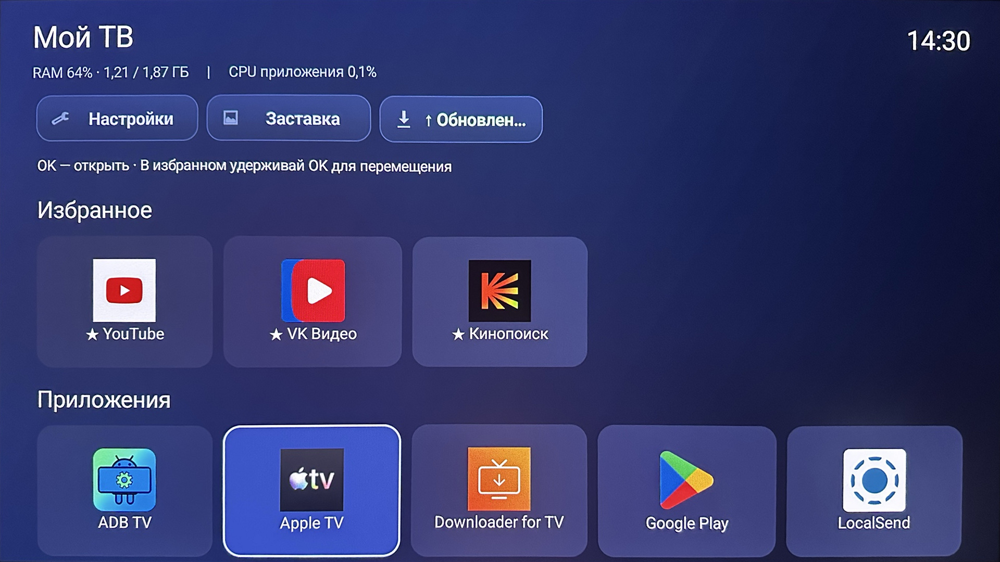

# Мой ТВ

### Приложения. Избранное. Пейзажи. Ничего лишнего.

Минималистичный лаунчер для Android TV и Google TV.

[Скачать APK](https://github.com/ncuKC/my-tv-launcher-app/releases/latest/download/My-TV.apk) · [Установка](#установка) · [Управление](#управление)

Android 8.0+ · Бесплатно · Без рекламы

Удобный домашний экран, где есть только нужное: приложения, избранное, часы и красивые пейзажи. Без навязанных рекомендаций и перегруженных меню. Всё управляется обычным пультом.

## Всё нужное под рукой

Добавляйте любимые приложения в избранное и расставляйте их в удобном порядке. Остальные приложения остаются в общей сетке, а ненужные можно скрыть. Настройте размер плиток и количество колонок под свой телевизор.

## Пейзажи вместо пустого экрана

Во время бездействия «Мой ТВ» может показывать фотографии из интернета или перемещающиеся часы. Выбирайте интервал смены фотографий, включайте подписи и часы поверх пейзажей, регулируйте яркость. Проверить результат можно прямо из настроек.

## Возможности

- Избранное с перемещением плиток с пульта.
- Общий список приложений по алфавиту.
- Скрытие ненужных приложений без удаления.
- Настройка размеров плиток и количества колонок.
- Заставка с интернет-пейзажами или часами.
- Часы и показатели использования памяти и процессора.
- Проверка и установка обновлений из приложения.
- Сохранение настроек между запусками.

## Скриншоты

### Приложения

### Настройки заставки

### Настройки лаунчера

## Установка

1. Скачайте `My-TV.apk` из [последнего релиза](https://github.com/ncuKC/my-tv-launcher-app/releases/latest).
2. Передайте файл на телевизор или приставку и откройте его.
3. Если Android запросит разрешение на установку из этого источника — предоставьте его и подтвердите установку.
4. Запустите «Мой ТВ».

### Сделать домашним экраном через TV Box Tools

Чтобы «Мой ТВ» открывался по кнопке Home, можно использовать **TV Box Tools — Launcher Manager ADB**.

1. Откройте TV Box Tools на телевизоре или приставке.
2. По подсказкам инструмента включите отладку ADB и подтвердите подключение.
3. В разделе управления лаунчерами выберите «Мой ТВ» — пакет `ru.mytv.launcher`.
4. Назначьте его домашним приложением.
5. Нажмите Home и проверьте, что открывается «Мой ТВ».

Названия пунктов могут отличаться в зависимости от версии TV Box Tools и прошивки. До проверки сохраните доступ к прежнему лаунчеру.

[Сайт TV Box Tools](https://tvboxtools.com/ru/)

## Управление

Стрелки — навигация, OK — запуск. Удерживайте OK в общей сетке для добавления в избранное или скрытия приложения. В избранном удержание OK включает перемещение: стрелки меняют положение, OK сохраняет, «Назад» отменяет.

## Бесплатно и без лишнего

Для телевизоров и приставок на Android TV / Google TV с Android 8.0 и новее.

Приложение распространяется бесплатно и предоставляется «как есть». [Условия распространения](LICENSE.md).

[Техническая информация](TECHNICAL.md) · [Все релизы](https://github.com/ncuKC/my-tv-launcher-app/releases)
