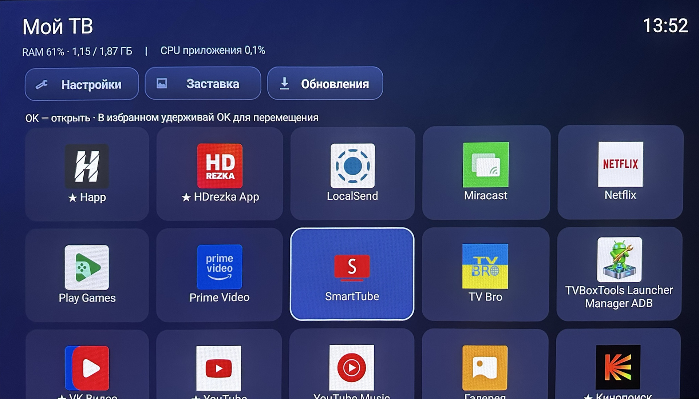
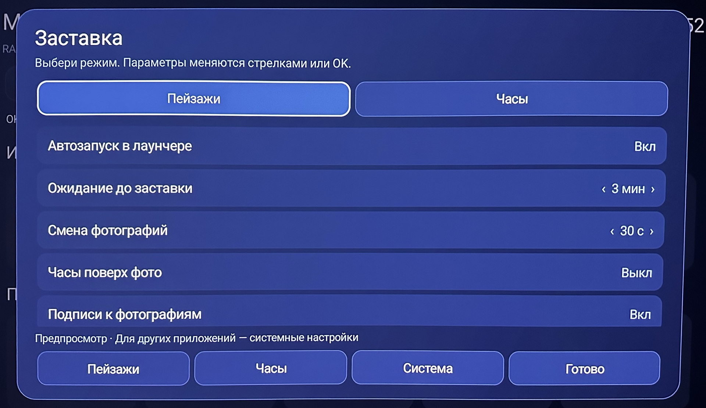
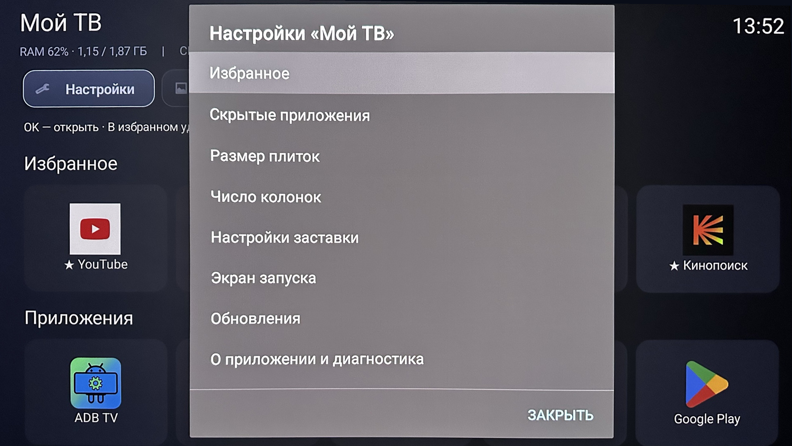

# Мой ТВ

### Приложения. Избранное. Пейзажи. Ничего лишнего.

Лёгкий по составу функций лаунчер для Android TV / Google TV с управлением пультом.
Без встроенной рекламы, рекомендаций, тяжёлого размытия и видеофонов.

[Скачать APK 1.0.0](https://github.com/ncuKC/my-tv-launcher-app/releases/download/v1.0.0/My-TV.apk) · [Все релизы](https://github.com/ncuKC/my-tv-launcher-app/releases) · [Установка](#установка-без-компьютера) · [Управление](#управление-пультом)

Android 8.0+ · Бесплатно · Предоставляется «как есть»

## Интерфейс

Реальные фотографии приложения на приставке пользователя, выровненные по перспективе; не макеты. Иконки и названия сторонних приложений показывают установленный на устройстве набор, не входят в комплект «Мой ТВ» и не означают связь с их разработчиками.

### Сетка приложений

Общая сетка с видимым фокусом, часами и статистикой. Нижняя часть ряда обрезана на исходной фотографии.

### Настройки заставки

Пейзажи и часы, интервалы, подписи и предпросмотр — в собственном окне без увеличения элементов при фокусе.

### Настройки лаунчера

Управление избранным, скрытыми приложениями, размерами плиток, колонками и параметрами запуска. Общее меню настроек использует стандартный Android-диалог.

## Что умеет Мой ТВ

### Домашний экран

- Тёмный сине-чёрный интерфейс со скруглёнными плитками и заметным фокусом пульта. Верхние кнопки не увеличиваются при выборе.
- Избранное сверху, общий список по алфавиту ниже. Обнаруживаются приложения с категориями LAUNCHER / LEANBACK_LAUNCHER, а не все системные пакеты.
- Запуск приложений, добавление и удаление из избранного.
- Прямое перемещение избранного: удерживать OK, отпустить, затем двигать стрелками, в том числе между рядами. Соседи сдвигаются; выбранная плитка слегка увеличивается и выделяется золотистой рамкой. Повторное OK сохраняет, Назад отменяет весь текущий перенос.
- Скрытие без удаления приложения и возврат через настройки. Скрытие убирает плитку и из избранного, но сохраняет признак избранного.
- Размеры плиток: компактные, обычные, крупные. Колонки: автоматически или 3–6.
- Сохранение настроек, избранного, его порядка и списка скрытых приложений.
- Начальный фокус первого избранного или первого приложения; восстановление фокуса после диалогов.
- Часы, кнопки настроек, заставки и обновлений.

### RAM и CPU

Измерения примерно раз в 5 секунд при открытом лаунчере. RAM показывает занятую и общую память устройства. Если прошивка позволяет чтение системной нагрузки, показывается «CPU приставки». Иначе явно выводится «CPU приложения», не нагрузка всей приставки. Во время подготовки после перезагрузки периодические измерения отложены.

### Заставка

- Режимы «Пейзажи» и перемещающиеся часы.
- Собственное окно с карточками режимов, текущими значениями и фокусом без увеличения элементов. Остальные меню могут оставаться стандартными Android-диалогами.
- Автозапуск на домашнем экране после 1, 3, 5, 10, 15 или 30 минут бездействия; по умолчанию 5 минут. Можно отключить.
- Смена фото через 30, 60, 120 или 300 секунд после показа.
- Часы поверх фото, подписи, размер и интервал перемещения часов, яркость. Изменения сохраняются сразу; неактуальные для режима параметры приглушены.
- Раздельный предпросмотр фото и часов. При поиске фото видна загрузка, при сбое — ошибка с Повторить/Назад, без подмены ошибки часами.
- В автоматической заставке при неудачной загрузке следующего фото остаётся прежний снимок, если он есть; иначе часы.
- Системная DreamService для совместимых прошивок. В других приложениях её запуск и таймер контролирует Android.

#### Новые пейзажи из интернета

Подборки из Wikimedia Commons и Openverse пополняются по мере просмотра. Темы и страницы поиска меняются между обращениями и запусками. Каталоги автоматически чередуются; Openverse запрашивается с исключением Wikimedia. Новый APK для новых результатов не нужен. Отдельных переключателей источников пока нет.

Для новых каталогов отбираются фото с метаданными CC0 / Public Domain, исходным размером от 1280×720 и соотношением сторон 1.3–3.0. Размер и декодирование проверяются после скачивания; для ограничения памяти разрешение может уменьшаться. Тематический поиск не заменяет ручную модерацию: содержание каждого результата не гарантируется. Название, автор и лицензия берутся из метаданных.

Три прежних снимка Unsplash — только аварийный резерв с соответствующей подписью. Динамического Unsplash API нет; названия и авторы резервных фото не заданы и не придумываются.

Фото не кэшируются на диске. Подборки находятся в оперативной памяти. Для уменьшения повторов локально сохраняются URL и хеши показанных снимков — до 256 записей, обычно по две на фото, — позиция поиска и сроки пауз каталогов. Это ограниченная история, не вечная защита от повторов.

При сбоях пробуются другие источники; после HTTP 429 каталог ставится на паузу. Доступность и выдача зависят от сети и API. Офлайн-фотоколлекции нет.

### Подготовка после перезагрузки

«Подготовка к работе…» показывается один раз после перезагрузки при запуске лаунчера в первые 3 минуты, если доступен системный счётчик загрузок. Длительность: выключено, 5, 10, 15, 20 или 30 секунд; по умолчанию 15 секунд. Пропуска нет, OK/Назад не сокращают ожидание.

Это задержка перед рабочим экраном, не ускоритель загрузки и не замена первого экрана Xiaomi. Обычный возврат из приложения её не включает. Поведение после сна отдельно не подтверждено; автозапуск зависит от прошивки.

### Обновления и диагностика

- Автопроверка наличия релиза при запуске и затем примерно каждые 20 минут при открытом лаунчере. В других приложениях новые периодические проверки не запускаются; начатый запрос может завершиться. Значок ↑ означает доступное обновление.
- Ручная проверка, скачивание APK с прогрессом и проверка пакета, версии и сертификата подписи; установка по нажатию пользователя. Автопроверка сама APK не устанавливает.
- Этапы, ошибки, закрытие/отмена и повтор; без параллельных ручных загрузок.
- Системное разрешение установки и подтверждение могут потребоваться. Возврат после установки зависит от прошивки.
- «О приложении и диагностика»: версия, пакет, модель, Android, время последней ручной проверки, последний результат и ошибка с датами, основные настройки, копирование отчёта. Это краткая диагностика, не полный журнал.

## Установка без компьютера

Минимум Android 8.0 / API 26. Предназначено для Android TV / Google TV; минимальная версия Android не означает проверенную совместимость со всеми устройствами. Установленными приложениями можно пользоваться без сети, если они сами её не требуют.

1. Откройте [последний выпуск](https://github.com/ncuKC/my-tv-launcher-app/releases/latest) на приставке или телефоне.
2. В Assets скачайте `My-TV.apk`. Source code не является установщиком.
3. Если файл скачан на телефон, передайте его на приставку доступным способом передачи по сети или через накопитель, если устройства это поддерживают. Конкретная программа передачи не обязательна.
4. Откройте APK файловым менеджером или загрузчиком на приставке. При запросе разрешите установку неизвестных приложений только тому приложению, через которое открываете файл. Названия экранов зависят от прошивки.
5. Подтвердите установку и откройте «Мой ТВ». Проверьте навигацию, запуск, избранное и заставку до смены домашнего экрана.

Для обычной установки не нужны root, специальные возможности или наложение поверх окон. Не отключайте системный или запасной лаунчер ради первой проверки.

### Назначить домашним экраном

«Мой ТВ» зарегистрирован как обработчик HOME. Если Android предлагает выбор после Home, выберите «Мой ТВ» и постоянное использование. Если прошивка предоставляет выбор домашнего приложения в настройках, используйте его. Установка APK сама по себе не гарантирует перехват Home.

#### Через TV Box Tools

Если обычного выбора нет, можно использовать сторонний [TV Box Tools](https://tvboxtools.com/ru/), также отображаемый как «TVBoxTools Launcher Manager ADB». Он предназначен для назначения установленного лаунчера домашним через ADB.

1. Сначала установите и проверьте «Мой ТВ» обычным запуском.
2. Откройте TV Box Tools; без компьютера используйте предлагаемый разработчиком вариант для приставки/телевизора.
3. Следуйте подсказкам инструмента: включите требуемый режим отладки и подтвердите подключение.
4. Выберите «Мой ТВ», пакет `ru.mytv.launcher`, и выполните назначение домашним приложением.
5. Проверьте Home из другого приложения и после перезагрузки.

TV Box Tools не входит в «Мой ТВ». Возможность смены HOME и названия пунктов зависят от версии инструмента и прошивки. Проверьте предлагаемые действия и способ возврата прежнего лаунчера. Не удаляйте запасной лаунчер и не отключайте системные пакеты наугад. Отключите отладку, если она больше не нужна. Установка инструмента на приставке видна на фото; отдельный полный тест назначения HOME этим способом для «Мой ТВ» не зафиксирован. Уже работающую конфигурацию другого лаунчера менять для проверки не требуется.

### Обновить установленное приложение

Нажмите «Обновления», дождитесь скачивания и проверки подписи, затем «Установить». Либо откройте новый My-TV.apk из Releases поверх установленного.

С 0.3.0 релизы используют постоянный ключ и пакет `ru.mytv.launcher`; в 1.0.0 они сохранены. Обычное обновление поверх сохраняет настройки. Удалять приложение перед ним не нужно.

У 0.1/0.2 и некоторых debug-сборок могла быть другая подпись. Не отключайте её проверку: убедитесь, что APK из этого репозитория. Переход с несовместимой подписи может потребовать удаления старой версии с потерей настроек; сначала обеспечьте доступный запасной домашний экран.

## Управление пультом

| Действие | Кнопки |
| --- | --- |
| Навигация / запуск | Стрелки / OK |
| Добавить в избранное или скрыть | Удерживать OK в общей сетке |
| Переместить избранное | Удерживать OK в избранном, отпустить, затем стрелки |
| Сохранить / отменить перенос | Повторное OK / Назад |
| Убрать из избранного | Настройки → Избранное → приложение; также меню плитки в общей сетке |
| Вернуть скрытое | Настройки → Скрытые приложения → снять отметку → Сохранить |
| Параметры окна заставки | Влево/вправо; OK переключает или увеличивает значение |
| Выйти из предпросмотра | Назад; при загрузке/ошибке есть экранная кнопка |
| Выйти из автоматической заставки | Любая кнопка пульта |
| Прокрутить домашний список к началу | Назад вне диалога и переноса |

## Совместимость и помощь

Основное устройство — Xiaomi TV Box S / Mi Box S 3rd Gen. На 14 ноября 2026 года есть положительная обратная связь пользователя. Это практическая проверка, не полный протокол испытаний каждого сценария; точная прошивка не зафиксирована. Другие модели не заявлены как проверенные.

HOME, системная заставка в других приложениях, сон/включение, общий CPU и установщик зависят от прошивки. Приложение не снимает ограничения Android.

При проблемах с фото откройте предпросмотр пейзажей и прочитайте ошибку. В Настройки → О приложении и диагностика → Скопировать доступен отчёт. Для [issue](https://github.com/ncuKC/my-tv-launcher-app/issues) укажите версию, модель, Android и шаги воспроизведения; перед публикацией проверьте текст на личные данные.

Данные и сетевые подключения

Настройки, история фото и краткая диагностика локальные; отчёт автоматически не отправляется. Запросы идут в GitHub для обновлений, Commons/Openverse для каталогов, на серверы фото из ответов и в Unsplash для резерва. Внешние сервисы получают обычные сетевые данные, включая IP-адрес.

Сборка и выпуск для разработчика

JDK 17, Gradle 8.9, SDK 35; [workflow](https://github.com/ncuKC/my-tv-launcher-app/actions/workflows/build.yml). Обычный push в main собирает debug с пакетом `ru.mytv.launcher.test`: он не заменяет релиз и не самообновляется.

Push с сообщением, начинающимся на `[release]`, запускает выпуск; альтернатива — ручной workflow с publish. Собираются debug и подписанный release, проверяется подпись, формируются SHA256SUMS.txt и APK-check.txt. После успешных шагов создаётся Release с My-TV.apk и SHA256SUMS.txt; описание из CHANGELOG.md. Артефакты Actions хранятся 3 дня, это не срок хранения Release. Компиляция не заменяет испытания на приставке.

Повышайте versionName и versionCode в app/build.gradle. Формула `major*10000 + minor*100 + patch`, minor/patch 0–99; 1.0.0 → 10000. Не переиспользуйте теги; пакет и ключ не меняйте.

Secrets: KEYSTORE_BASE64, KEYSTORE_PASSWORD. PKCS12, alias launcher, пароль ключа совпадает с паролем хранилища. Не публикуйте ключ и пароль в коде, issues или логах. Храните отдельную защищённую резервную копию: замена ключа не позволит обычное обновление установленных релизов.

## Условия распространения

Мой ТВ распространяется бесплатно и предоставляется «как есть», без гарантий в пределах, допускаемых применимым законодательством. [Полный текст условий](LICENSE.md).

Это собственные условия проекта, не лицензия MIT или Apache. Они не устанавливают дополнительных разрешений на изменение исходников, сублицензирование или коммерческое распространение. Лицензии фотографий и права на сторонние иконки и названия не меняются этими условиями.
